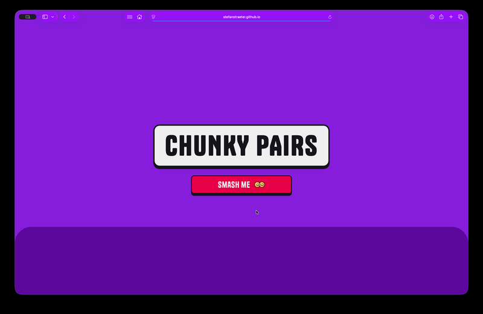

<div align="center">

# CHUNKY PAIRS

**Flip cards, find matching pairs and race the clock in a head-to-head memory game.**

TypeScript · Vite · SCSS

[Live demo](https://stefanstraeter.github.io/chunky-pairs/)

<br />



</div>

---

## About

Chunky Pairs is a mobile-first memory card game with a bold Neo-Brutalist look. Choose a board, pick a visual theme and starting player, then compete in local multiplayer. Find matching pairs before the turn timer runs out and see who claimed the most pairs.

The project was developed as part of a frontend training program at Developer Akademie. It focuses on responsive layouts, modular TypeScript and a theme system built with CSS custom properties.

---

## Highlights

- **Three board sizes** – Choose a 16-, 24- or 36-card game.
- **Local multiplayer** – Two players take turns on the same device. Scores update as pairs are found.
- **Timed turns** – Each turn has a 10-second countdown. A timeout passes the turn to the other player.
- **Two visual themes** – Switch between Retro Arcade and Pastel Punch.
- **Clear match flow** – Set up a game, play on a shuffled board, then view the winner or a draw on the results screen.
- **Responsive interface** – Layouts adapt for smaller screens, with touch-friendly cards and controls.
- **Tactile details** – Animated card flips, press effects and playful end-screen interactions bring the game to life.

---

## Tech Stack

- **TypeScript** for game state, interactions and screen controllers
- **Vite** for local development and production builds
- **SCSS / CSS** with modular styles, responsive layouts and theme variables
- **HTML** templates rendered by the application
- **Tanker** self-hosted display font

---

## Getting Started

```bash
git clone https://github.com/stefanstraeter/chunky-pairs.git
cd chunky-pairs
npm install
npm run dev
```

Open the local URL printed by Vite (usually `http://localhost:5173/chunky-pairs/`).

Create a production build with:

```bash
npm run build
```

To preview the production build locally:

```bash
npm run preview
```

<details>
<summary><strong>Project structure</strong></summary>

<br />

```text
src/
├── features/                 # Screen-specific templates, controllers and game logic
│   ├── game/                 # Board, card interactions and turn timer
│   ├── home/                 # Landing screen
│   ├── result/               # Winner and score screen
│   └── setup/                # Theme, player and board-size selection
├── styles/                   # SCSS design system and page styles
│   ├── abstracts/            # Variables and mixins
│   ├── base/                 # Reset and typography
│   ├── components/           # Buttons, cards and modal
│   └── pages/                # Screen-specific layouts
├── ui/                       # Screen navigation and theme configuration
├── main.ts                   # Application entry point
├── state.ts                  # Shared game state
└── types.ts                  # Shared TypeScript types

public/
├── fonts/                    # Self-hosted Tanker font
└── img/                      # Theme previews, card art and interface assets
```

The application moves between the home, game setup, game board and results screens without a page reload.

</details>

---

## Good to know

Chunky Pairs is a client-side game. Game state and scores exist only for the current session; there is no account system, backend or online multiplayer.

---

## Author

**Stefan Sträter** · [github.com/stefanstraeter](https://github.com/stefanstraeter/)
